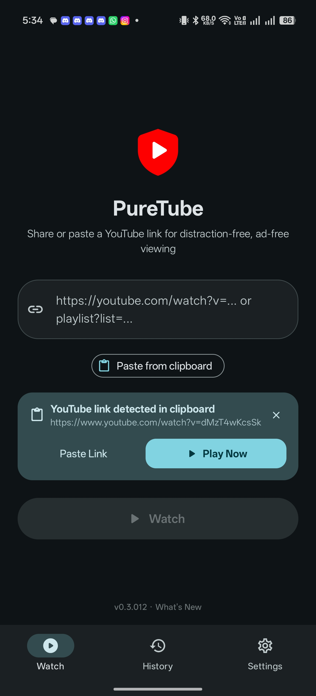
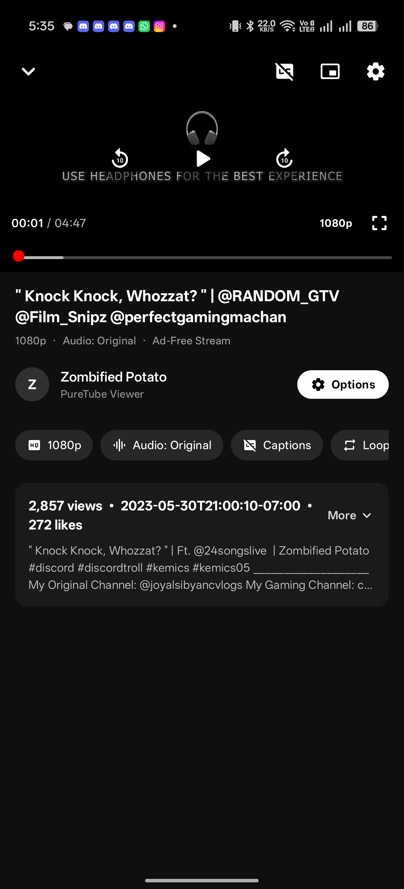
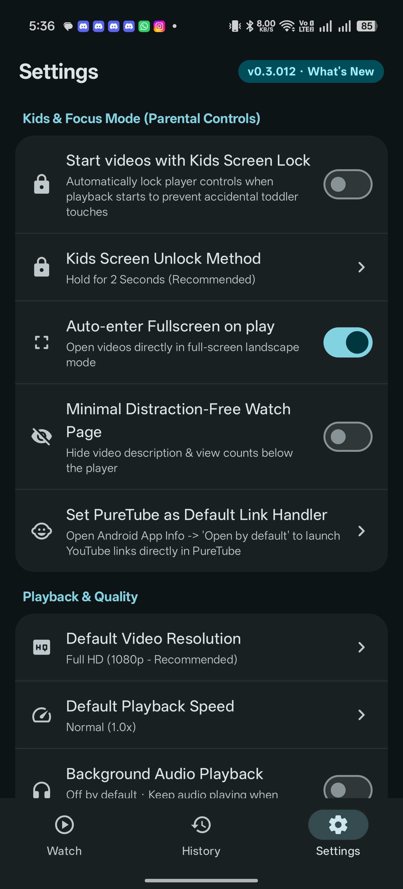
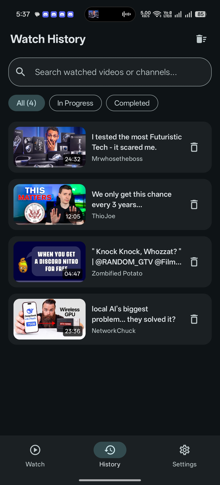
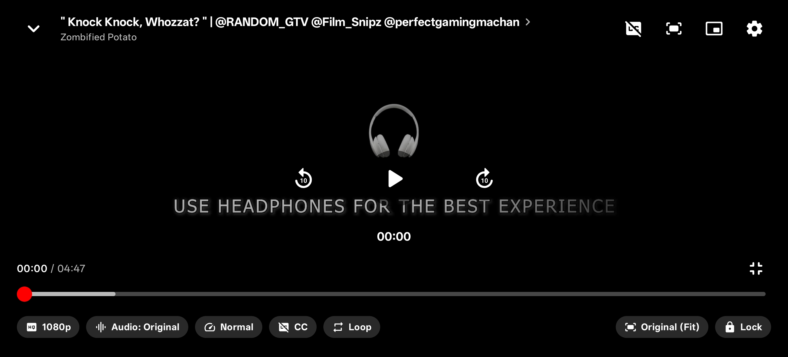
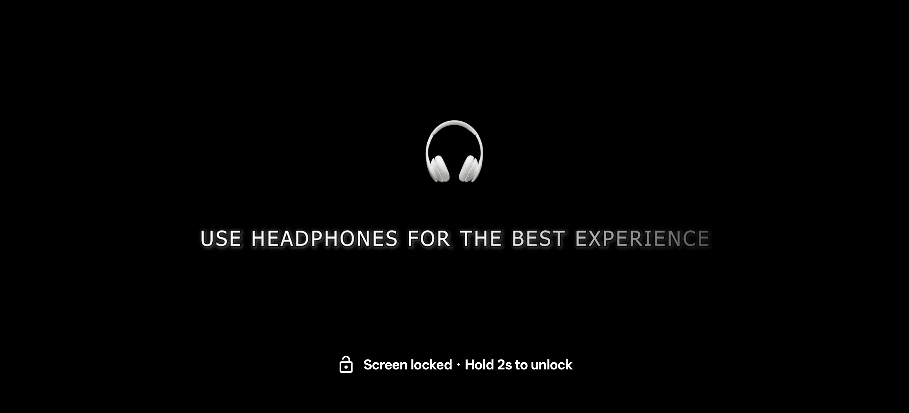

<div align="center">

<a href="https://github.com/joyalsiby/PureTube">
  
</a>

# PureTube

### Just the video. Nothing else.

**An ad-free, distraction-free YouTube player for kids, parents, and anyone who wants to focus.**<br />
No ads · No search · No Shorts · No recommendations

<br />

[](https://github.com/joyalsiby/PureTube/releases/latest)
&nbsp;
[](#-install)

<br />

[](https://github.com/joyalsiby/PureTube/actions)
[](https://github.com/joyalsiby/PureTube/releases)
[](https://github.com/joyalsiby/PureTube/releases/latest)
[](LICENSE)

[**📖 Full Guide**](docs/GUIDE.md) &nbsp;·&nbsp; [**📝 Changelog**](PROJECT_LOG.md) &nbsp;·&nbsp; [**🐞 Report an Issue**](https://github.com/joyalsiby/PureTube/issues) &nbsp;·&nbsp; [**🌐 joyalsiby.com**](https://joyalsiby.com)

</div>

---

## 💡 How It Works

The official YouTube app hits you with ads, Shorts, autoplay, and a search bar that pulls kids (and adults) somewhere else. **PureTube plays the one video you picked, and that's all it does.**

<table>
<tr>
<td align="center" width="33%">
<h3>🔒</h3>
<b>Lock YouTube</b><br />
<sub>Keep the official app locked or disabled on your child's device.</sub>
</td>
<td align="center" width="33%">
<h3>📲</h3>
<b>Share one link</b><br />
<sub>Tap <code>Share → PureTube</code> from any app, or paste a link.</sub>
</td>
<td align="center" width="33%">
<h3>🎯</h3>
<b>Watch only that</b><br />
<sub>No feed, no comments, no "Up Next". When the video ends, it stops.</sub>
</td>
</tr>
</table>

---

## 📱 Screenshots

<div align="center">

| Watch & Clipboard Detection | Portrait Player | Kids & Focus Controls | Watch History |
| :---: | :---: | :---: | :---: |
|  |  |  |  |

| Fullscreen Player Controls | Toddler-Proof Screen Lock (`Hold 2s`) |
| :---: | :---: |
|  |  |

</div>

---

## ✨ Highlights

<table>
<tr>
<td width="50%" valign="top">

#### 🧒 Kids & Focus Mode
Start videos with the screen locked. It unlocks with a 2-second hold or a parent math challenge. Auto-fullscreen and a minimal watch page are optional.

</td>
<td width="50%" valign="top">

#### 🎬 A Real Player
Up to 4K / 60fps, **Original** audio by default, captions, chapters, clickable timestamps, loop, and playlists.

</td>
</tr>
<tr>
<td width="50%" valign="top">

#### 👆 Natural Gestures
Double-tap to seek, long-press for `2x` speed, swipe to change brightness or volume, and pinch to zoom.

</td>
<td width="50%" valign="top">

#### 🔔 PiP & Media Controls
Picture-in-Picture you can close, optional background audio, and notification and lockscreen controls. No Premium needed.

</td>
</tr>
<tr>
<td width="50%" valign="top">

#### ⚡ Fast & Cool
Near-instant start thanks to stream preloading and anti-throttling requests. Hardware decoding keeps battery use low.

</td>
<td width="50%" valign="top">

#### 🔄 One-Tap Updates
The built-in updater checks GitHub Releases, downloads the new version, and installs it over the current one.

</td>
</tr>
</table>

<p align="center"><a href="docs/GUIDE.md#-features-in-depth"><b>See every feature in detail →</b></a></p>

---

## ⚖️ PureTube vs. YouTube

| | YouTube / YouTube Kids |  **PureTube** |
| :--- | :---: | :---: |
| Video ads | ❌ Pre-roll, mid-roll & sponsored cards | ✅ **None** |
| Home feed & Shorts | ❌ Endless scrolling | ✅ **Link-only** |
| Search & related videos | ❌ Easy to wander off | ✅ **None** |
| Toddler screen lock | ❌ Manual or missing | ✅ **Built in** |
| Background play & PiP | 💰 Premium only | ✅ **Free** |
| Tracking & accounts | ❌ Google account & watch tracking | ✅ **No account, history stays on device** |

---

## 📦 Install

| Method | How |
| :--- | :--- |
| ⬇️ **Direct APK** | Download `PureTube-v*.apk` from the [latest release](https://github.com/joyalsiby/PureTube/releases/latest) and open it on your phone. |
| 🔁 **Obtainium** | In [Obtainium](https://github.com/ImranR98/Obtainium), tap **Add App** and paste `https://github.com/joyalsiby/PureTube`. |
| 🔄 **Updates** | Built in: **Settings → Check for Updates**. |

> [!NOTE]
> PureTube isn't on the Play Store, so **Google Play Protect** may ask you to scan it on first install. Tap **Scan app** or **More details → Install anyway**. Every release is signed with the same key, so updates won't ask again. [Why this happens →](docs/GUIDE.md#-google-play-protect-warning)

---

## 🛠️ Built With

[](https://kotlinlang.org)
[](https://developer.android.com/jetpack/compose)
[](https://developer.android.com/media/media3)
[](https://github.com/TeamNewPipe/NewPipeExtractor)
[](https://square.github.io/okhttp/)
[](https://developer.android.com/training/data-storage/room)

Build it yourself with **JDK 17** and the Android SDK:

```bash
./gradlew assembleRelease        # Windows: gradlew.bat assembleRelease
```

The [Full Guide](docs/GUIDE.md) covers the architecture, project layout, live dependency versions, and the automated release process.

---

<div align="center">

### 👨‍💻 Made by Joyal Siby

*Product Designer, UI/UX Specialist & Creative Developer*<br />
<sub>“I create experiences — not just pixels.”</sub>

[](https://joyalsiby.com)
[](https://github.com/joyalsiby)

<sub>Released under the <a href="LICENSE">MIT License</a> · If PureTube helps your family, consider giving it a ⭐</sub>

</div>
